**[Install it](#installing)** — through the Marketplace on Home Assistant
2026.11 and newer, or HACS on anything older.

Home maintenance tracking in the Home Assistant sidebar. Filters, flushes,
batteries and services — what was last done, what is due, and what supplies
you have on the shelf for it.

It runs entirely inside Home Assistant — no cloud account, no second app, and
nothing to keep in sync. Your data lives in Home Assistant's own storage, so it
is covered by the backups you already take.

<p>
  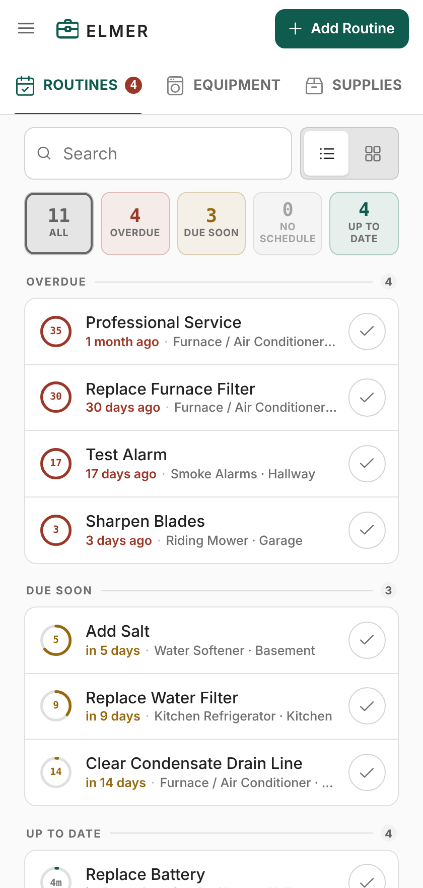
  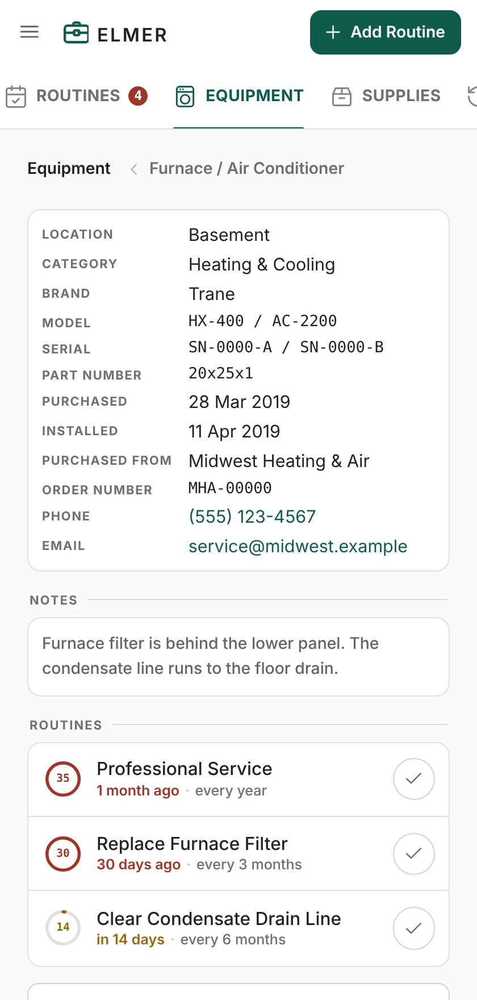
  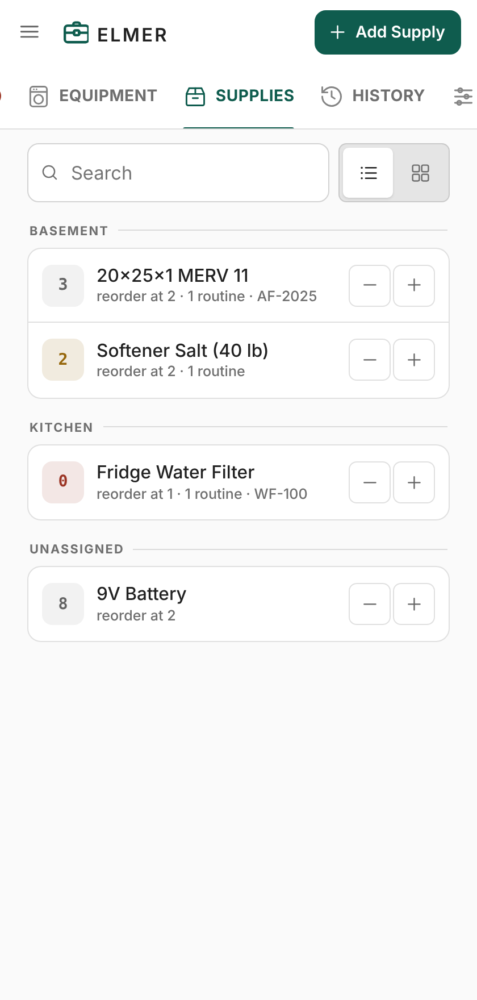
</p>

---

## What you get

**A panel in the sidebar.** Five screens — Routines, Equipment, Supplies, History and
Settings — and a sixth, Animals, if you turn it on.

The chrome does not move. A header and one tab row, in the same place at every
width and on every screen; everything else is page content that scrolls. The add
button sits at the end of the header and says what it adds — "Add Routine", "Add
Equipment" — so a control whose action changes with the screen still tells you
what it will do before you press it. Screens with nothing to add leave it out,
and because it is last in the row nothing else moves.

<p>
  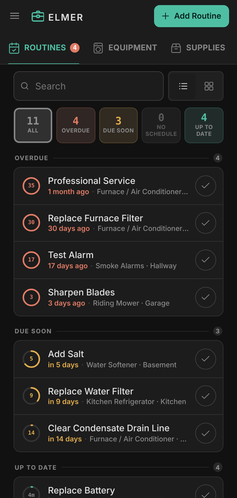
  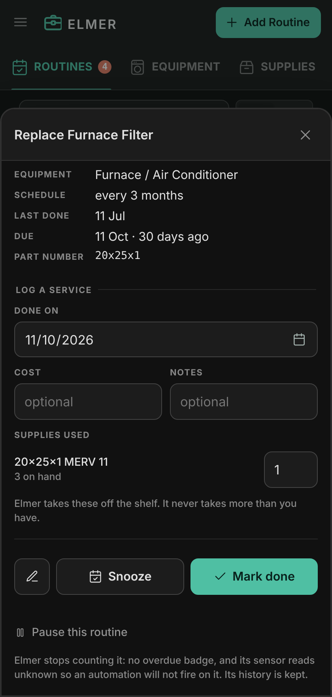
  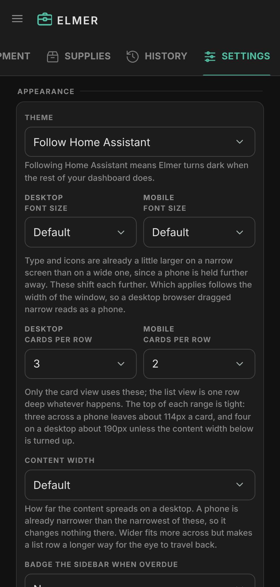
</p>

On a wider screen the same layout stretches; nothing is rearranged.

<p>
  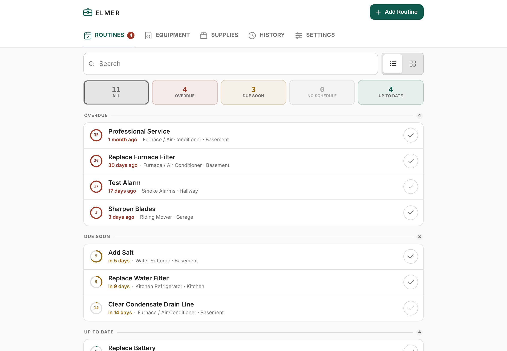
</p>

**Either list, as a list or as cards.** Routines, Equipment and Supplies each
remember which shape you chose, and how many cards go in a row is yours to set
— separately for a desktop and a phone, because a count picked at a desk
should not follow you onto a screen that has no room for it.

**Schedules that suit the job.** Four of them. Most things run on an interval:
every three months, every year. Anything tied to the weather does not —
winterize the pool late one November and an interval moves it later every year
after — so those can be anchored to **months** instead, and land in the same
month however late you get to them. Smoke alarm batteries go on the **clock
change**, spring or fall or both, on the United States dates. And anything with
a date of its own gets one, either every year or **once only**: a job with an
end. Once it is done it leaves the lists and lives in the history; its history
entry has an **Edit routine** button if you need it back — to change the date,
or make it yearly after all.

Only an interval needs to have been done before it knows anything. The other
three know their own dates, so a routine you have never done still says when it
is next due rather than reading as unscheduled — and an interval you have never
done is due the day you add it, and overdue from the day after.

**A history that reads like one.** Every service you mark done is kept, grouped
by year and then by month, with what it cost in a column of its own and a total
on any month that had more than one. Each entry remembers what it was for, so
history still says "Furnace" after the furnace has been replaced and deleted.
Costs can be turned off under Settings if you do not keep them.

**Not now, without losing track.** Snooze a routine for a few days and it drops
out of the overdue list and comes back on its own. The day it comes back is
its new due date, so it still counts down — "in 3 days · Snoozed" — and sits
under Due soon when that day is inside your warning window, or under Snoozed
when it is further off. Pause is the other half of that: indefinite, for
things you genuinely are not tracking at the moment.

<p>
  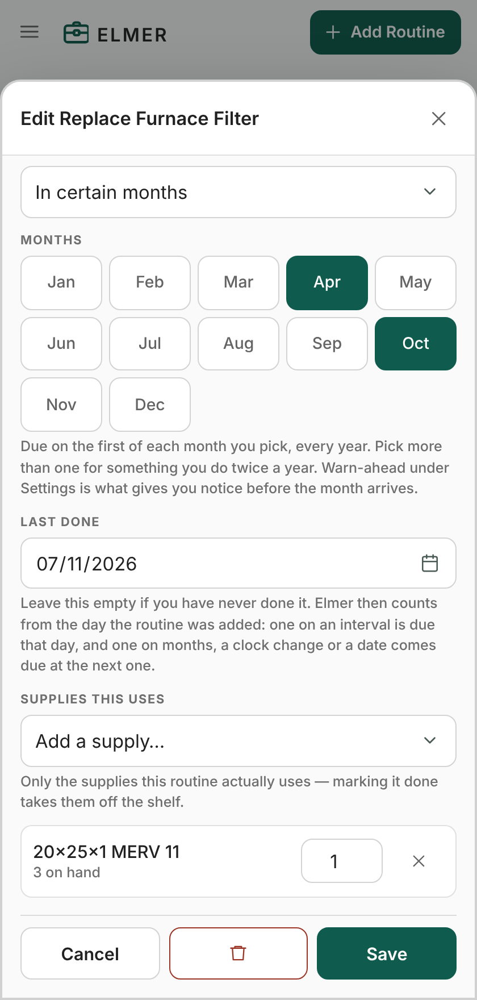
  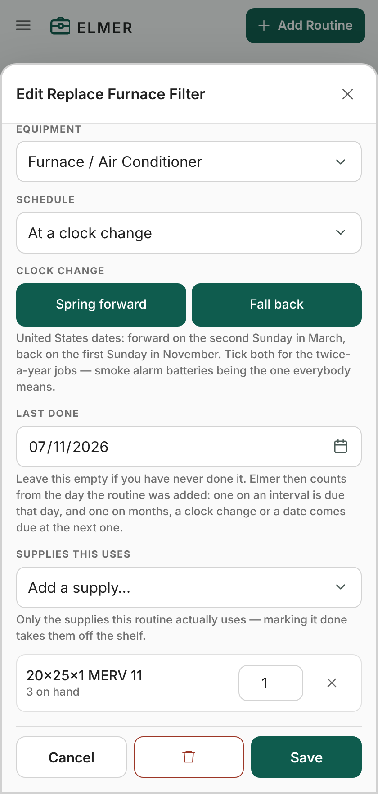
  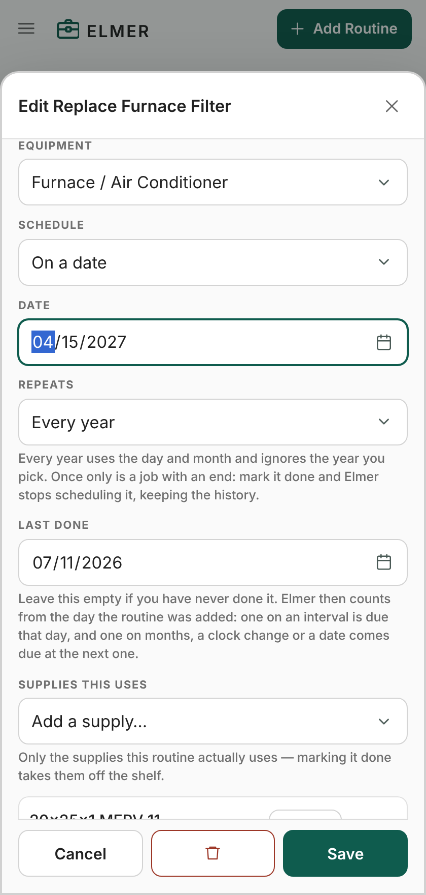
</p>

<p>
  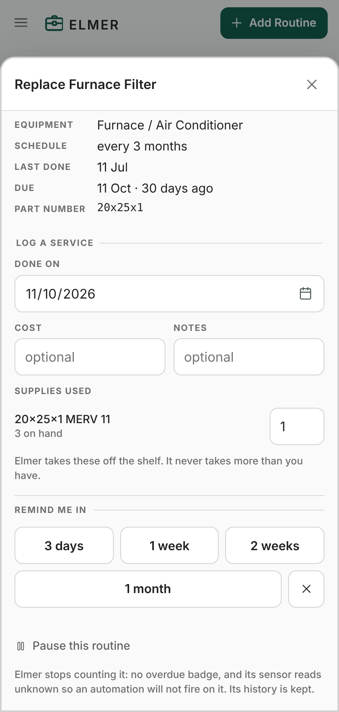
  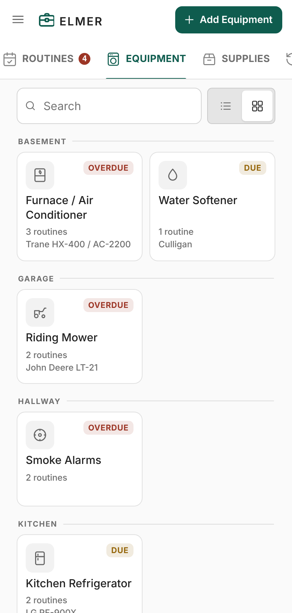
</p>

**Animals, if you have them.** Off by default. Set **Settings ▸ Animals** to
**On** for a tab of pets and livestock, between Equipment and Supplies; its
**Add Animal** button does the rest. Each animal gets the details you would
want to hand a sitter or a vet — species, breed, sex, birthdate, color,
weight and height, microchip and license, where it came from and when, the
vet's number and email, insurance, diet and notes — with its age worked out
for you and its next birthday on its page. **Add medication** and **Add
vaccination** build a list of each: a medication and its dosage, a vaccine and
the date it was given, latest first on the animal's page.

Horses and farm animals use their own words for sex — mare and gelding, doe
and buck, hen and rooster — and have **How many**, for a flock kept as one
record. Species is a list you build, like categories: the menu offers the
species your animals use, typing one of Elmer's own ("horse", "dog") brings it
back with its icon, and **Settings ▸ Species** renames or removes them. Each
animal can have an icon of its own, as equipment does. Locations are one list
shared by equipment, animals and supplies, so the barn holds the tractor, the
horse and the hay alike.

Weights are in pounds or kilograms — **Settings ▸ Weigh animals in**, which
follows Home Assistant's unit system until you choose. Each weight keeps the
unit it was typed in, so switching converts every animal rather than
relabelling it.

Their routines are ordinary Elmer routines: heartworm every month, the farrier
every seven weeks, the coop every month — on the same list, with the same
overdue badge, sensors and history as the furnace filter. Deleting an animal
works the way deleting equipment does; turning Animals off asks first, then
deletes every animal and its routines, keeping their history. Equipment is
untouched either way. Importing a backup that has animals in it turns the tab
back on.

<p>
  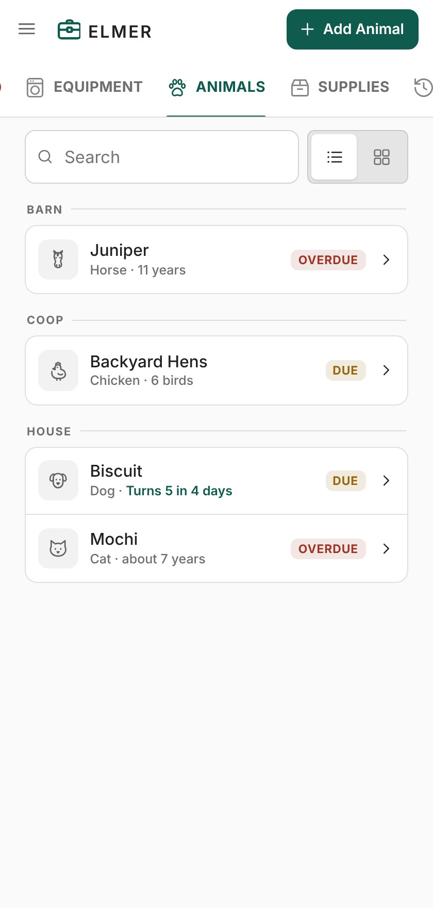
  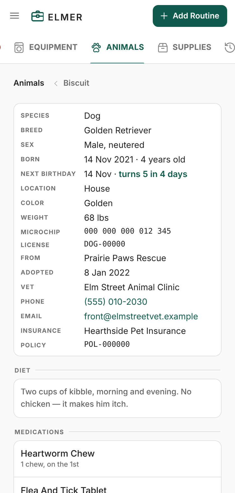
  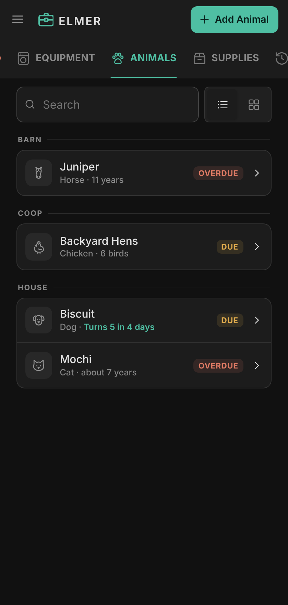
</p>

**Entities, so the rest of Home Assistant can act on it.**

| Entity | What it is |
| --- | --- |
| `sensor.elmer_overdue` | How many routines are past due. Attributes list them. |
| `sensor.elmer_due_soon` | How many fall inside your warning window. |
| `sensor.elmer_on_track` | How many are neither late nor nearly due. |
| `sensor.elmer_parts_to_reorder` | Supplies at or below their reorder point. |
| `sensor.elmer_parts_short` | Supplies a due routine needs more of than you have. |
| `sensor.elmer_next_due` | Days until the next thing that isn't already overdue. |
| one per routine | Days until due — **negative when overdue**, counting to the day it wakes while snoozed, `unknown` while paused or once a one-time routine is done. |

The two supply sensors kept the names they had when the tab was called Parts,
so automations written against them go on working. The `adjust_stock` action
likewise still takes the supply's name as `part`.

Per-routine sensors are grouped under a device per piece of equipment, or per
animal, so the furnace's routines sit together and so do the dog's; an
animal's device lists its breed as the model. Days-until is the state rather than a date
because it is what a condition wants to compare: `below: 0` is overdue,
`below: 7` is next week, no template needed.

**Services**: `elmer.complete`, `elmer.undo`, `elmer.adjust_stock`,
`elmer.import_json`, `elmer.export_json`.

**On your dashboard.** Elmer is a sidebar panel, but the counts above are
ordinary sensors, so putting them on a dashboard needs no custom card and no
extra download. Edit a dashboard, **+ Add card**, scroll to **Manual**, and
paste:

```yaml
type: glance
title: ELMER
state_color: false
entities:
  - entity: sensor.elmer_overdue
    name: Overdue
  - entity: sensor.elmer_due_soon
    name: Due soon
  - entity: sensor.elmer_on_track
    name: On track
```

Add `icon: elmer:elmer` to an entity to use Elmer's own mark — the icon set is
registered on every page, so it is available anywhere in Home Assistant, not
just inside the panel. If the entities do not resolve, check the real ids under
**Developer tools → States** and filter for `elmer`; they differ if the
integration was renamed or set up more than once.

---

## Installing

### Through the Marketplace

Home Assistant **2026.11 and newer**. The Marketplace is built in; it replaced
HACS, and is where custom integrations are installed now.

1. Settings ▸ **Marketplace**
2. **Add from link**, in the top right — not the ⋮ menu
3. Paste `https://github.com/philecker/elmer-ha` (or just
   `philecker/elmer-ha`) and select **Add**. If you are asked what sort of
   content it is, choose **Integration** and add it again
4. Open **Elmer** and install it
5. **Restart Home Assistant** — a new integration's Python is only loaded at
   startup
6. Settings ▸ Devices & services ▸ **Add integration** ▸ Elmer

Elmer appears in the sidebar straight away. There is nothing to configure.

The Marketplace reads custom repositories from GitHub directly, so the first
time you add one it asks you to connect a GitHub account. That is GitHub's
device sign-in, and it does not ask for access to private repositories.

### Through HACS

Home Assistant **2026.10 and older**, where HACS is still how this is done.

[](https://my.home-assistant.io/redirect/hacs_repository/?owner=philecker&repository=elmer-ha&category=integration)

That button opens this repository in your own Home Assistant. By hand instead:

1. HACS ▸ ⋮ ▸ **Custom repositories**
2. Add this repository's URL, type **Integration**
3. Find **Elmer** in HACS and install it
4. **Restart Home Assistant**
5. Settings ▸ Devices & services ▸ **Add integration** ▸ Elmer

If you later update to 2026.11, there is nothing to redo: HACS is removed on
the first start after the update and what it had installed — Elmer included —
is carried over to the Marketplace.

### By hand

Copy `custom_components/elmer` into your `config/custom_components/` folder, so
you end up with `config/custom_components/elmer/manifest.json`. Then restart and
add the integration as above.

### Requirements

Home Assistant **2025.7 or newer**. Earlier versions lack
`async_register_static_paths`, which is how the panel's files are served.

---

## Importing a backup

If you have an `elmer.json` from somewhere else, bring it in from
**Settings ▸ Data export ▸ Import Data** — pick the file, check what Elmer
says is in it, and choose whether to merge or replace.

To do it from a script instead, put the file in your Home Assistant **config**
folder (the one with `configuration.yaml`) and run the action:

```yaml
action: elmer.import_json
data:
  path: elmer.json
  merge: true
```

`merge: true` matches records by id and updates them in place, so importing a
newer export later updates what changed and loses nothing. `merge: false`
replaces everything, history included.

Older files are migrated on the way in: a part number that used to live on a
routine is lifted to its equipment, a single `contact` field is routed to phone
or email by what it looks like, and `links` becomes the replacement-parts list.
A file with animals in it turns Animals on, and a weight written as text —
"68 lb", "31 kg" — becomes a number with its unit.

The path has to be inside your config folder. That is deliberate — an action can
be triggered from a script, a dashboard button or the voice assistant, so the
path it is handed is not necessarily one you typed.

---

## Where your data lives

In Home Assistant's own storage, at `.storage/elmer`. That means it is included
in your Home Assistant backups and restored with them — you do not need a
separate backup for Elmer.

**Settings ▸ Data export** has both halves:

- **Export Data** downloads the file through your browser.
- **Import Data** reads a backup you pick, shows you what is in it, and asks
  whether to merge it into what is here or replace everything.

Both work from a phone over Nabu Casa, because the file is read and written in
the browser rather than on the server — there is nothing to copy into the config
folder first.

The same thing is available as the `elmer.export_json` and `elmer.import_json`
actions if you would rather drive it from a script. `elmer.export_json` with a
`path` writes a file into your config folder; with no path it returns the data in
the action response.

Every route produces the same JSON, so a copy taken one way imports the other.

---

## Automations

Because routine sensors are days-until, the conditions read plainly:

```yaml
# Tell me on Saturday morning if anything is overdue.
triggers:
  - trigger: time
    at: "09:00:00"
conditions:
  - condition: time
    weekday: [sat]
  - condition: numeric_state
    entity_id: sensor.elmer_overdue
    above: 0
actions:
  - action: notify.mobile_app_phone
    data:
      title: Overdue maintenance
      message: >-
        {{ state_attr('sensor.elmer_overdue', 'names') | join(', ') }}
```

```yaml
# Order supplies before the routine that needs them comes round.
triggers:
  - trigger: numeric_state
    entity_id: sensor.elmer_parts_short
    above: 0
actions:
  - action: notify.mobile_app_phone
    data:
      title: Order supplies
      message: >-
        {{ state_attr('sensor.elmer_parts_short', 'names') | join(', ') }}
```

`sensor.elmer_parts_short` answers a different question from
`sensor.elmer_parts_to_reorder`. The reorder sensor watches each supply against
its own threshold. This one adds up what every routine due inside the warning
window actually needs — two routines sharing a filter are counted together —
and reports the supplies where that total comes to more than is on the shelf. A
supply can sit comfortably above its reorder point and still be one short of
what next week needs, and only this sensor sees it. Its `parts` attribute
carries `needed`, `on_hand`, `short` and the routines asking for each one.

```yaml
# Mark the furnace filter done from a dashboard button.
actions:
  - action: elmer.complete
    data:
      routine: "Furnace / Air Conditioner: Replace Furnace Filter"
```

A routine's plain name works too. If two routines share a name, qualify it with
the equipment as above — an ambiguous name fails the call rather than picking
one at random. An animal's routines work the same way, by its name:

```yaml
# A heads-up three days before the farrier is due.
triggers:
  - trigger: numeric_state
    entity_id: sensor.juniper_farrier
    below: 4
actions:
  - action: notify.mobile_app_phone
    data:
      message: "Juniper's farrier is due in {{ states('sensor.juniper_farrier') }} days."
```

The entity id comes from the animal's and the routine's names; check it under
**Developer tools → States** if yours differ.

---

## Remote access

Nothing to set up. The panel talks over the authenticated websocket Home
Assistant already has open to your browser, so Nabu Casa and a VPN both work
with no extra configuration, and nothing new is exposed to your network.

---

## Known limits

- **One household.** There is no per-user data; everyone who can see the panel
  sees the same house.
- **No notifications of its own.** Home Assistant does that better; the sensors
  are there for it.
- **Admin-only import.** Anyone who can open the panel can tick routines off and
  edit equipment, but replacing the whole data set is held to the same bar as a
  configuration change.
- **The icon needs 2026.3, and the store listing may not show it at all.**
  Elmer ships its own brand images in `custom_components/elmer/brand/`, which
  Home Assistant serves from 2026.3 onwards — before that, a custom
  integration's images had to live in `home-assistant/brands`, and that
  repository now auto-closes pull requests for custom integrations. So on
  2026.3 or newer the integrations page shows the toolbox; on anything older it
  shows a placeholder and there is no way round it. HACS showed a placeholder
  in its own panel either way, because it requested the image straight from
  `brands.home-assistant.io` rather than through Home Assistant's
  authenticated proxy —
  [hacs/integration#5223](https://github.com/hacs/integration/issues/5223) —
  and the Marketplace listing may do the same. It says nothing about the
  install; the sidebar and the panel header draw their own mark regardless.

---

## Contributions

Thanks to [@adamnorth](https://github.com/adamnorth) for the feedback that
made Elmer better.

---

## Support

Elmer is built and maintained by **Phil Ecker**. It is free and open source,
and everything it records stays on your own Home Assistant — no account, no
tracking, nothing sent anywhere.

Bug reports and ideas are welcome, over on
[the issue tracker](https://github.com/philecker/elmer-ha/issues).

If it has saved you a forgotten filter change or two, you are very welcome to
[buy me a coffee](https://buymeacoffee.com/philecker).

---

**[Install it](#installing)** — through the Marketplace on Home Assistant
2026.11 and newer, or HACS on anything older.
